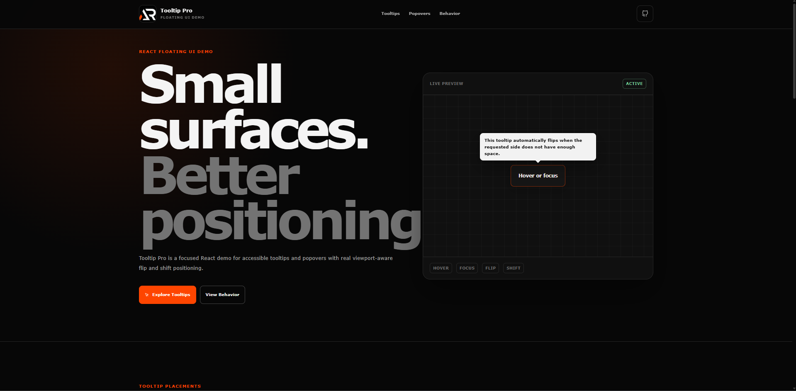

# Tooltip Pro

Tooltip Pro is a responsive React demo for accessible tooltips and popovers with custom viewport-aware positioning.

The project includes tooltip placement, real flip behavior, viewport shifting, keyboard interaction, click and hover triggers, focus handling, and interactive popovers without using a third-party positioning library.



## Features

- 12 tooltip placement options
- Viewport-aware flip positioning
- Automatic viewport shifting
- Hover and keyboard focus tooltips
- Click-triggered tooltips
- Interactive popovers
- Escape key support
- Outside-click closing
- Popover focus handling
- Responsive positioning on scroll and resize
- Responsive desktop and mobile interface
- Fixed header with scroll-aware visibility
- Mobile navigation
- Floating back-to-top control
- Accessible labels, focus states, and ARIA attributes

## Tech Stack

- React
- Vite
- styled-components
- React Icons
- JavaScript
- HTML
- CSS

## Project Structure

```text
tooltip-pro
├── public
│   ├── favicon.ico
│   ├── logo.png
│   └── preview.png
│
├── src
│   ├── components
│   │   ├── backToTop
│   │   ├── footer
│   │   ├── header
│   │   └── tooltipPro
│   │
│   ├── pages
│   │   └── home
│   │
│   ├── App.jsx
│   ├── index.css
│   └── main.jsx
│
├── .gitignore
├── eslint.config.js
├── index.html
├── LICENSE
├── package.json
├── README.md
├── screenshot.png
└── vite.config.js
```

## Getting Started

Clone the repository:

```bash
git clone https://github.com/a2rp/tooltip-pro.git
cd tooltip-pro
```

Install dependencies:

```bash
npm install
```

Start the development server:

```bash
npm run dev
```

Create a production build:

```bash
npm run build
```

Run ESLint:

```bash
npm run lint
```

## Tooltip Usage

```jsx
import { Tooltip } from "./components/tooltipPro";

<Tooltip content="Helpful information" placement="top">
    <span>Hover or focus</span>
</Tooltip>;
```

Click-triggered tooltips are also supported:

```jsx
<Tooltip
    content="Click again or press Escape to close."
    placement="bottom"
    trigger="click"
>
    <span>Click tooltip</span>
</Tooltip>
```

## Popover Usage

```jsx
import { Popover } from "./components/tooltipPro";

<Popover
    label="Information"
    title="Popover title"
    placement="bottom-start"
    trigger={<span>Open popover</span>}
>
    <p>Interactive popover content.</p>
</Popover>;
```

## Positioning

Tooltip Pro first calculates the requested placement without modifying its coordinates.

If the requested side overflows the viewport, the opposite placement is tested. The better placement is selected and the final coordinates are shifted inside the visible viewport when required.

The positioning is recalculated while the floating surface is open during scrolling and viewport resizing.

## Deployment

The project is configured for GitHub Pages.

Build and deploy with:

```bash
npm run deploy
```

Live site:

https://a2rp.github.io/tooltip-pro/

## Future Prospects

- Additional collision handling strategies
- Configurable tooltip arrows
- Controlled open and close state
- Reusable package distribution
- Additional positioning customization

## License

This project is licensed under the MIT License.

## Links

- Portfolio: https://www.ashishranjan.net
- GitHub: https://github.com/a2rp
- CodePen: https://codepen.io/ash1198
- LinkedIn: https://www.linkedin.com/in/aashishranjan
- Facebook: https://www.facebook.com/theash.ashish
- YouTube: https://www.youtube.com/channel/UCLHIBQeFQIxmRveVAjLvlbQ
- Email: mailto:ash.ranjan09@gmail.com

## Support

- Support: https://a2rp-donation-page.netlify.app/
- Buy Me a Coffee: https://buymeacoffee.com/a2rp
- Patreon: https://www.patreon.com/a2rp
